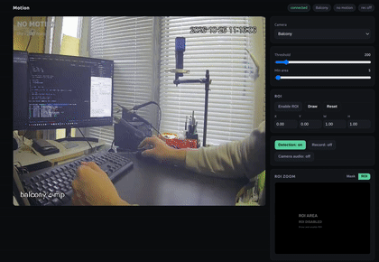

<!-- 

# make gif
ffmpeg -i version2.mp4 -vf "fps=5,scale=420:-1:flags=lanczos,split[s0][s1];[s0]palettegen[p];[s1][p]paletteuse" version2.gif 

rm -rf .venv
uv venv --python 3.11 
source .venv/bin/activate
uv pip install -e ".[dev]"

If you don't want to activate the venv every time
uv can run commands directly inside the venv:

uv run pytest -q
uv run mypy app
uv run python -m app.main

pip install files-to-prompt

files-to-prompt . -e py -e html -e js --ignore-gitignore --ignore-gitignore -n -o output.txt

# dry run first
python apply_edits.py dump.txt edits.json --dry-run -v

# if dry run shows all "would write", apply
python apply_edits.py dump.txt edits.json -v

-->

# OpenCV Motion Detection System

## 📋 Описание проекта

Система детекции движения с веб-интерфейсом для IP-камер. Принимает RTSP-поток, выделяет движение алгоритмом MOG2, автоматически записывает короткие клипы вокруг события, проигрывает звук с камеры в браузере и хранит индивидуальные ROI и параметры чувствительности для каждой камеры.

## ✅ Что реализовано

- **MJPEG-стриминг** — `/stream.mjpg` с рамкой ROI и счётчиками
- **Маска движения** — `/mask.mjpg` (то, что видит анализатор)
- **SSE-события** — `/events` для статуса, записи и переключения камер
- **Детекция движения** — MOG2 с фильтрацией теней
- **Автоматическая запись** — pre-roll буфер и пост-ролл
- **Аудио с камеры** — `/audio.wav` + кнопка включения в UI
- **Переключение камер** — без перезапуска сервера
- **Per-camera ROI** — рисуется мышью или пальцем в браузере, хранится в `roi_settings.json` в нормализованных координатах
- **Per-camera пороги** — `motion_threshold` и `min_area` задаются для каждой камеры отдельно

## 🚧 В планах

- Уведомления о движении (Telegram / email / webhook)
- Несколько одновременных потоков

## ✨ Основные возможности

- **Детекция движения** — вычитание фона (MOG2) с настраиваемыми threshold и min_area
- **Автоматическая запись** — клипы вокруг события, с буфером перед началом движения
- **Аудио с камеры** — воспроизведение в браузере, включается по клику
- **ROI** — прямоугольная область интереса, отдельная для каждой камеры
- **Переключение камер** — смена источника без перезапуска процесса
- **Статус в реальном времени** — SSE `/events`
- **Однопоточный захват** — один поток владеет `cv2.VideoCapture`, переключение камер не приводит к гонкам и падениям

## 🏗️ Архитектура

    refactoring_motion_detector/
    ├── app/
    │   ├── main.py                # FastAPI + lifespan
    │   ├── settings.py            # Pydantic-настройки, settings.yaml
    │   ├── models.py              # ROISettings, MotionParamsRequest, Status
    │   ├── container.py           # Services (DI) + RuntimeState
    │   ├── deps.py                # FastAPI Depends: get_services
    │   ├── capture.py             # OpenCVSource + CaptureService (1 поток)
    │   ├── motion.py              # MotionAnalyzer (чистый MOG2)
    │   ├── composer.py            # FrameComposer + encode_jpeg
    │   ├── recorder.py            # Recorder: pre-roll, кодеки, prune
    │   ├── audio.py               # AudioService (ffmpeg passthrough)
    │   ├── events.py              # EventBus (потокобезопасный SSE)
    │   ├── roi.py                 # ROIManager + resolve_motion_params
    │   └── routers/
    │       ├── pages.py           # /
    │       ├── stream.py          # /stream.mjpg, /mask.mjpg, /events
    │       ├── control.py         # /api/cameras, /api/params, /api/detection …
    │       ├── roi.py             # /api/roi/…
    │       ├── recordings.py      # /api/recordings
    │       └── audio.py           # /audio.wav
    ├── app/static/                # HTML/CSS/JS без сборки
    ├── tests/                     # unit, API, synthetic, real-video E2E
    ├── settings.yaml.example      # шаблон конфига
    └── pyproject.toml             # пакет, ruff, mypy, pytest

## 🚀 Установка и запуск

### Требования

- Python 3.11+
- OpenCV (opencv-python-headless)
- FFmpeg в PATH (только для аудио)
- IP-камера с RTSP-потоком

### Установка

    git clone <repository-url>
    cd refactoring_motion_detector

    python -m venv .venv
    source .venv/bin/activate      # Linux / macOS
    # .venv\Scripts\activate       # Windows

    pip install -e ".[dev]"

### Настройка камер

    cp settings.yaml.example settings.yaml

`settings.yaml` в .gitignore. Формат:

    cameras:
      Balcony:
        url: "rtsp://192.168.0.102:8554/balcony_camera"
        has_audio: true
      Kitchen:
        url: "rtsp://192.168.0.102:8554/kitchen"
        has_audio: true

    default_camera: "Balcony"

    # Пороги по умолчанию. Камера без своих значений использует их.
    motion_threshold: 200
    min_area: 5
    analysis_fps: 5.0

### Запуск

    python -m app.main

Открыть `http://localhost:8080`.

### Тесты

    pytest                              # unit + API
    <!-- pytest -s -k dump                   # покадровая диагностика клипа -->
    mypy app                            # проверка типов
    ruff check app tests                # линтер

Клипы для tests/test_real_video.py кладутся в `tests/data/` и регистрируются в `CLIPS` в том же файле.

## 📡 API эндпоинты

| Метод | Эндпоинт | Описание |
|-------|----------|----------|
| GET | `/` | Веб-интерфейс |
| GET | `/api/cameras` | Список камер, выбранная, дефолтная |
| POST | `/api/camera` | Переключение камеры |
| GET | `/stream.mjpg` | MJPEG видеопоток |
| GET | `/mask.mjpg` | MJPEG маска движения |
| GET | `/events` | SSE (status / camera) |
| GET | `/audio.wav` | Аудиопоток (WAV) |
| POST | `/api/detection` | Вкл/выкл детекцию (глобально) |
| POST | `/api/recording` | Вкл/выкл запись (глобально) |
| POST | `/api/params` | Per-camera threshold / min_area, опционально глобальные detection_enabled / recording_enabled |
| GET | `/api/params/{camera_name}` | Текущие параметры камеры |
| GET | `/api/status` | Последний SSE-снапшот статуса |
| GET | `/api/health` | capture_ok, возраст последнего кадра |
| GET | `/api/recordings` | Список записей |
| GET | `/api/recordings/{name}` | Скачать запись |
| DELETE | `/api/recordings/{name}` | Удалить запись |
| GET | `/api/roi/{camera_name}` | ROI камеры |
| POST | `/api/roi` | Установить ROI |
| POST | `/api/roi/{camera_name}/reset` | Сбросить ROI к полному кадру |

## ⚙️ Параметры настройки

### Детекция (per-camera, переопределяет глобальные)

- **motion_threshold** — суммарная площадь контуров в пикселях дисплея, при которой фиксируется движение (по умолчанию 200)
- **min_area** — минимальная площадь одного контура, меньшие отбрасываются (по умолчанию 5)

### Запись

- record_buffer_seconds — pre-roll (2 сек)
- record_after_seconds — сколько тишины ждать до остановки (3 сек)
- min_record_seconds — минимальная длина клипа (3 сек)
- max_record_seconds — жёсткий лимит (300 сек)
- record_fps — частота сохраняемого mp4 (10 fps)
- recordings_keep — сколько последних клипов держать (100)

## 🖥️ Веб-интерфейс

- Живой поток + маска движения
- Панель управления: выбор камеры, слайдеры threshold и min_area (per-camera), кнопки Detection / Record / Camera audio, ROI: включить / нарисовать / сбросить, поля X/Y/W/H
- Статус-строка: соединение, камера, движение, запись
- Уведомления о движении (WebAudio)

## 🎯 Алгоритм детекции

1. **Захват кадра** — RTSP или локальный файл, один поток
2. **Ресайз** — к display_width × display_height
3. **Обрезка ROI** — при включённом ROI анализ идёт только по нему
4. **MOG2** — вычитание фона, пиксели тени (127) отбрасываются
5. **Контуры** — фильтр по min_area, сумма площадей
6. **Решение** — area > motion_threshold
7. **Запись** — старт при движении, стоп после record_after_seconds тишины или max_record_seconds

## 🛠️ Разработка

    python -m app.main          # обычный запуск
    DEV=1 python -m app.main    # с autoreload

    mypy app
    ruff format app tests
    ruff check app tests
    pytest -q

### Добавление тестового клипа

1. Положить mp4 в tests/data/
2. В tests/test_real_video.py в CLIPS добавить ("имя.mp4", ожидаемое_число_событий)
3. Одно «событие» — непрерывная серия кадров с detected=True, разделённая хотя бы одним кадром detected=False

## 📄 Лицензия

MIT